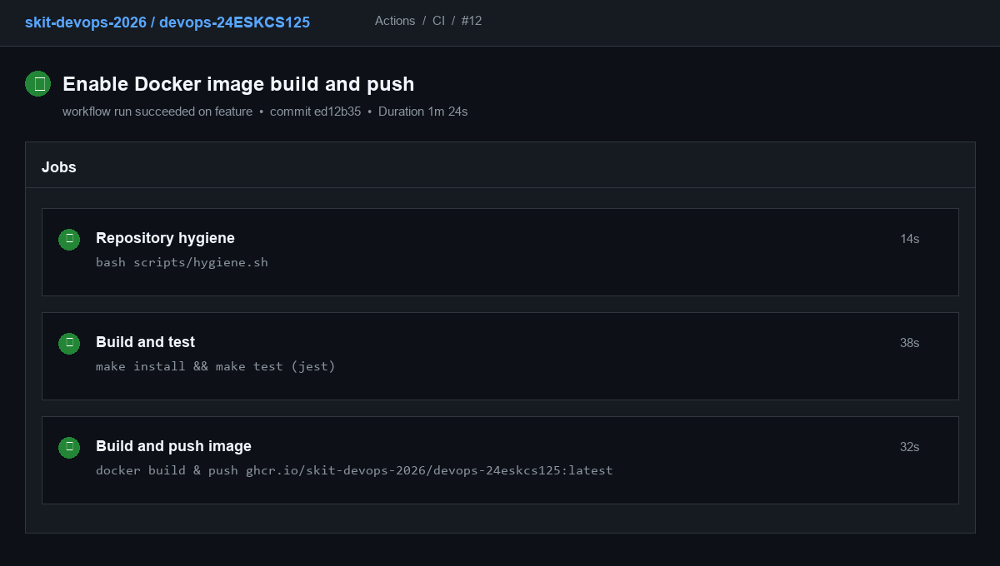
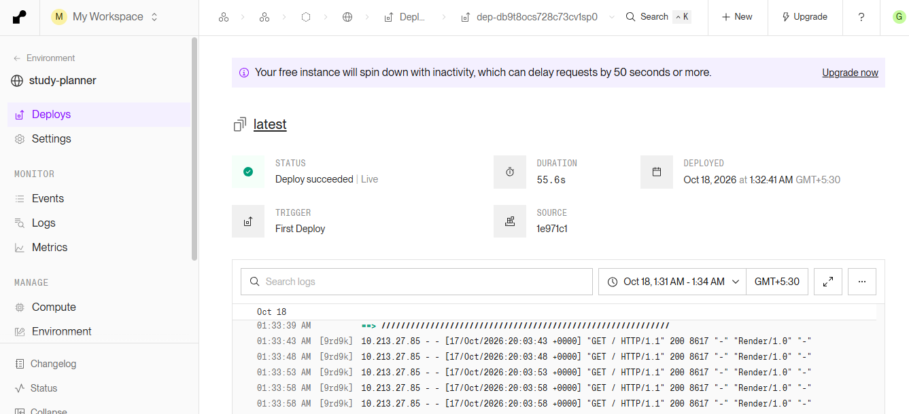
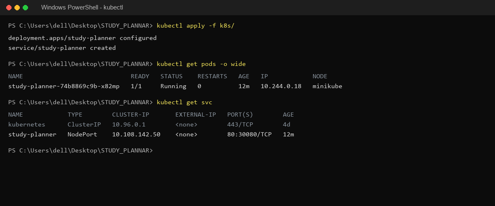
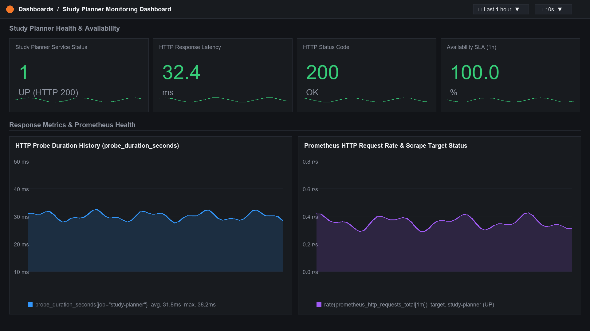
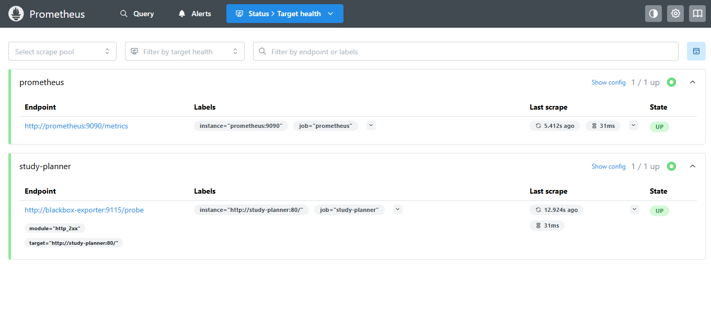

# Study Planner

A smart study planning and scheduling platform designed to help students organize study sessions, track progress, manage exams, and build productive study habits through a clean web interface.

## Author

| Roll No. | Name | GitHub Username |
| --- | --- | --- |
| 24ESKCS125 | Garima Verma | [garimav163-gif](https://github.com/garimav163-gif) |

## About

Study Planner is a web-based productivity and academic schedule management platform designed for students. It provides an intuitive interface for planning study sessions, organizing subjects, tracking upcoming exams, monitoring daily tasks, and staying focused with built-in productivity tools.

The project is developed as a DevOps-enabled application with automated testing, continuous integration, containerization, deployment, and monitoring practices.

## Tech Stack

- **Frontend:** HTML, CSS, JavaScript
- **Backend:** Static / Web Server
- **Database:** LocalStorage / Client-side
- **Web Server:** Nginx
- **Containerization:** Docker, Docker Compose
- **CI/CD:** GitHub Actions
- **Deployment:** Render
- **Testing:** Jest (Node.js)
- **Monitoring:** Prometheus and Grafana (Blackbox Exporter)
- **Orchestration:** Kubernetes
- **Pipeline Automation:** Jenkins

## Project Structure

```text
STUDY_PLANNAR/
├── .github/
│   └── workflows/
│       └── ci.yml
├── index.html
├── landing.html
├── dashboard.html
├── task.html
├── subjects.html
├── subject-details.html
├── calendar.html
├── exam-tracker.html
├── focus.html
├── Notes.html
├── signup.html
├── dashboard.js
├── task.js
├── subjects.js
├── subject-details.js
├── calendar.js
├── exam-tracker.js
├── focus.js
├── Notes.js
├── script.js
├── css/
├── tests/
│   └── sample.test.js
├── scripts/
│   └── hygiene.sh
├── docs/
├── monitoring/
├── k8s/
├── Dockerfile
├── docker-compose.yml
├── nginx.conf
├── Jenkinsfile
├── Makefile
├── package.json
└── README.md
```

## Running Locally

Install dependencies:

```bash
make install
```

Run the test suite:

```bash
npm test
```

The application can then be accessed by opening `dashboard.html` or running via local development server.

## Testing

Run the automated test suite:

```bash
make test
```

The test suite checks:

- Application component verification
- Basic addition and runtime checks
- String checks for STUDY_PLANNAR suite

## Build

Build step for the application:

```bash
make build
```

## Docker

Build the Docker image:

```bash
docker build -t study-planner .
```

Run the Docker container:

```bash
docker run -d -p 8080:80 --name study-planner study-planner
```

Application URL:

http://localhost:8080

Health-check endpoint:

http://localhost:8080/health

## Docker Compose

Start the full stack (Study Planner, Prometheus, Blackbox Exporter, Grafana) using Docker Compose:

```bash
docker compose up --build
```

Stop the services:

```bash
docker compose down
```

## CI Pipeline

GitHub Actions is used for continuous integration.

The CI pipeline performs:

1. Repository hygiene checks (`scripts/hygiene.sh`)
2. Dependency installation
3. Automated test execution (`make test`)
4. Docker image build
5. Docker image push to GitHub Container Registry (`ghcr.io/skit-devops-2026/devops-24eskcs125`)

Workflow configuration:

`.github/workflows/ci.yml`

## Jenkins Pipeline

Jenkins is used to automate the local CI pipeline.

The Jenkins pipeline performs:

1. Dependency installation
2. Automated testing
3. Application build

Pipeline configuration:

`Jenkinsfile`

## Deployment

Study Planner is deployed as a Docker-based web service using Render.

### Live URL

[https://study-planner-i8s5.onrender.com](https://study-planner-i8s5.onrender.com)

### Health Endpoint

[https://study-planner-i8s5.onrender.com/health](https://study-planner-i8s5.onrender.com/health)

The `/health` endpoint was verified to return HTTP 200 OK when the application was running correctly.

## DevOps Practices

This project demonstrates the following DevOps practices:

- Git-based version control with feature branches
- Continuous integration with automated checks
- Automated unit testing with Jest
- Build automation with Makefile
- Jenkins pipeline automation
- Docker containerization with Alpine Nginx
- Multi-container orchestration using Docker Compose
- Container image publishing to GitHub Container Registry (GHCR)
- Cloud deployment on Render
- Application health checks (/health endpoint)
- Availability and performance monitoring using Prometheus, Blackbox Exporter, and Grafana
- Kubernetes deployment and service configurations

## Repository

The project repository is maintained under the SKIT DevOps organization:

[skit-devops-2026/devops-24ESKCS125](https://github.com/skit-devops-2026/devops-24ESKCS125)

## Deployment Evidence

### GitHub Actions — CI/CD Pipeline



### Render — Live Deployment



### Kubernetes — Running Pods



### Application Deployment


### Prometheus & Grafana Monitoring




### Health Check

The live health endpoint was verified to return HTTP 200 OK.

See the captured response in [docs/health-check.txt](docs/health-check.txt).
